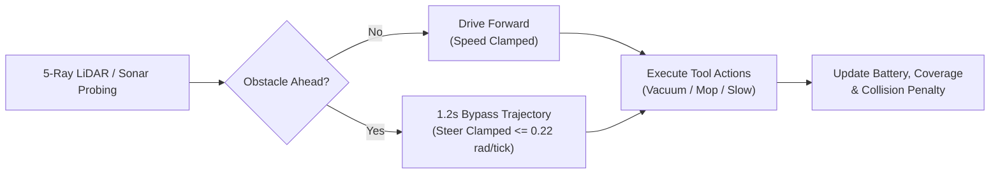

# 🤖 CollabPEAS: Dyadic AI Agent Design Platform (v0.3)

[](https://github.com/)
[](https://cscw.acm.org/)
[-brightgreen.svg)]()
[]()
[-lightgrey.svg)]()

> **CollabPEAS** is an interactive, browser-based co-design research platform for dyadic pairs of non-expert human designers to collaboratively specify, program, simulate, and debug household autonomous agents using the **PEAS framework** (**P**erformance, **E**nvironment, **A**ctuators, **S**ensors).
>
> Re-engineered from a multi-user 3D Unity VR environment (`fusion-vr-training-2.0.6`) into a lightweight, high-fidelity **dual-engine 360-degree interactive web platform**.

---

## ⚡ Quickstart

No build tools, no `npm install`, and no Docker required! The platform runs out of the box using any standard local web server.

### 1. Clone the Repository
```bash
git clone https://github.com/<your-username>/CollabPEAS.git
cd CollabPEAS
```

### 2. Launch the Local Server
Choose either **Node.js** or **Python 3**:

```bash
# Option A: Node.js (Recommended - supports byte-range streaming for 3D GLB)
node collabpeas-2d/server.js 8088

# OR Option B: Python 3 (Zero-setup alternative on macOS / Linux / Windows)
python3 -m http.server 8088
```

### 3. Open in Your Browser
Navigate to:
```
http://localhost:8088
```
> [!TIP]
> **Recommended Browsers**: Google Chrome, Apple Safari, Microsoft Edge, or Mozilla Firefox with WebGL hardware acceleration enabled.

---

## 🌟 What is CollabPEAS?

Specifying autonomous AI agents (such as robotic vacuum cleaners) is notoriously difficult for non-technical users due to subtle coupling between physical environments, sensor limitations, actuator constraints, and control logic.

CollabPEAS addresses this by operationalizing the classical AI **PEAS framework** into a visual, dyadic co-design workflow:
- **P (Performance)**: Dynamic multi-attribute utility weights (Coverage %, Battery Life, Collision Avoidance, Human/Pet Safety).
- **E (Environment)**: Spatial exploration of an authentic 3D apartment with rooms, furniture obstacles, roving pets, and liquid spills.
- **S (Sensors)**: Physical sensor configuration within an 11-slot hardware capacity budget.
- **A (Actuators)**: Motorized mobility and cleaning tool assembly.
- **Decision Logic**: Visual 4-slot vibe-coding rule chains (`SENSE` ➔ `CONDITION` ➔ `ACTION` ➔ `CONTROL`) evaluated in real-time at 10Hz.

---

## 🗺️ Dual-Engine 360° Spatial Navigation

CollabPEAS features a flexible dual-engine architecture that lets you switch between 3D WebGL and 2D blueprint modes seamlessly from the top header:

```
[ 🌐 3D 360° ]   [ 🚶 FPS 360° ]   [ 📐 2D Map ]
```

### 1. 🌐 3D 360° Orbit Mode (Three.js WebGL)
- **Authentic Apartment Model**: Loaded from `collabpeas-2d/assets/Apartment.glb` (419 nodes, 220 meshes, 42 materials).
- **Smooth 360° Orbiting**: Left-click and drag to rotate the camera smoothly around the apartment horizontally (azimuth $0^\circ - 360^\circ$) and vertically (pitch from top-down $90^\circ$ to ground level).
- **Pan & Zoom**: Right-click drag to pan across rooms; mouse wheel to zoom in and out.
- **Interactive Holographic Stations**: Floating glowing 3D rings inside the rooms highlight on hover. Clicking any ring immediately pops open that Step's workstation modal!
- **Floor Raycast Navigation**: Left-click anywhere on the floor slab to walk the operator avatar directly to that position.

### 2. 🚶 First-Person Walkthrough (FPS 360° Mode)
- **Eye-Level Exploration**: Experience the apartment at human eye level ($1.65\text{m}$).
- **WASD Locomotion**: Walk through hallways and interior doorways using <kbd>W</kbd><kbd>A</kbd><kbd>S</kbd><kbd>D</kbd> or Arrow Keys.
- **Mouse Look**: Drag the mouse to inspect rooms in full 360 degrees.

### 3. 📐 2D Rotatable Blueprint Mode
- **Architectural Vector Floor Plan**: Crisp, high-contrast floor blueprint showing room boundaries, dimensions, dirt piles, and water puddles.
- **Continuous 360° Rotation**: Rotate the 2D blueprint using <kbd>Q</kbd> / <kbd>E</kbd> keys or the compass dial.
- **Teleport Pads**: Click room labels to instantly glide the viewport between the Living Room, Kitchen, Bedroom, Bathroom, Dining Room, and Balcony.

### 4. 🧭 Interactive 360° Compass Widget
- **Live Heading Readout**: Top-right compass rose displaying real-time camera azimuth (e.g., `🧭 0° N`, `🧭 45° NE`, `🧭 90° E`, `🧭 180° S`, `🧭 270° W`).
- **Drag-to-Spin Dial**: Click and drag the circular compass rim to smoothly rotate the entire apartment.
- **Cardinal Snap Buttons**: 1-click camera alignment to cardinal views:
  - <kbd>N</kbd> (0° North)
  - <kbd>E</kbd> (90° East)
  - <kbd>S</kbd> (180° South)
  - <kbd>W</kbd> (270° West)
  - <kbd>ISO</kbd> (45° Isometric 3D angle)
  - <kbd>🔄</kbd> (Toggle auto-spinning 360° cinematic orbit)

---

## 🤖 Autonomous Cleaning Robot Simulation

In Step 5, the autonomous cleaning robot runs live in both 3D and 2D environments:



### Visual Features & Cues
- **Chassis**: High-contrast metallic disc ($y = 0.20\text{m}$ elevation in 3D).
- **Headlights**: Dual forward white spotlight beams indicating current locomotion heading.
- **Rotating Turret**: Animated top LiDAR spinner actively sensing environment geometry.
- **Ground Beacon**: Pulsing circular light halo expanding underneath the robot.
- **Reactive LED Status Ring**:
  - 🔵 **Blue**: Vacuum motor active (`VACUUM ON`).
  - 🔷 **Cyan**: Mop deployed (`MOP DEPLOY`).
  - 🟡 **Amber**: Human detected nearby (`SET SPEED SLOW`).
  - 🔴 **Red**: Hazard avoidance / Cat emergency brake (`BRAKE STOP`).
  - 🟣 **Purple**: Returning to charging dock (`DOCK RETURN`).
- **Unoccluded Overhead HUD Badge**: Billboard sprite (`🤖 CLEANING ROBOT [ACTION • BATT%]`) rendered with `depthTest: false` so it is always visible through interior walls.
- **Camera Tracking Controls**:
  - **`🤖 Focus Robot`**: Centers camera on the robot's current position.
  - **`🎥 Follow Robot`**: Locks camera to smoothly track the robot across rooms.

### Simulation Physics
- **10Hz Continuous Evaluation**: Evaluates active rule chains in parallel every $100\text{ms}$.
- **Multi-Ray Clearance Probing**: Scans 5 forward rays ($\pm 0^\circ, \pm 30^\circ, \pm 60^\circ$) to navigate narrow doorways and avoid corner entrapment.
- **Continuous Drive with Tool Operations**: The robot maintains forward locomotion while vacuuming, mopping, or blinking LEDs.
- **Smart Obstacle Bypass**: Automatically triggers a 1.2-second smooth detour around furniture obstacles.

---

## 🎮 Controls & Keybindings Reference

| Context | Input | Action |
| :--- | :--- | :--- |
| **3D 360° Orbit** | **Left Mouse Drag** | Orbit camera 360° horizontally & vertically |
| | **Right Mouse Drag** | Pan camera across floor |
| | **Mouse Wheel** | Zoom smoothly in / out (2.5m - 35m) |
| | **Left Click on Station Ring** | Open corresponding Step Workstation modal |
| | **Left Click on Floor** | Raycast click to walk operator avatar to spot |
| **FPS Walkthrough** | <kbd>W</kbd> <kbd>A</kbd> <kbd>S</kbd> <kbd>D</kbd> / Arrows | Walk forward, back, strafe left/right |
| | **Mouse Drag** | Look around 360° horizontally and vertically |
| **2D Blueprint** | <kbd>Q</kbd> / <kbd>E</kbd> | Rotate 2D map counter-clockwise / clockwise |
| | **Mouse Drag** | Pan 2D map |
| | **Mouse Wheel** | Zoom 2D map |
| **Global Controls** | <kbd>Space</kbd> | Open workstation modal (or enter nearest station) |
| | <kbd>Esc</kbd> | Close workstation popup and return to 360° map |
| | **Compass Buttons** | Snap camera to N, E, S, W, or 45° ISO |
| | <kbd>🔄</kbd> Button | Toggle auto-spinning 360° cinematic orbit |
| | **`🎥 Follow Robot`** | Toggle camera tracking lock on cleaning robot |

---

## 📋 The 5-Step PEAS Specification Flow

Clicking the floating 3D holographic rings (or pressing <kbd>Space</kbd>) opens the corresponding Step Workstation modal:

```
[ Step 1: Metrics ] ➔ [ Step 2: Sensors ] ➔ [ Step 3: Actuators ] ➔ [ Step 4: Logic ] ➔ [ Step 5: Simulation ]
```

### 1. Step 1: Purpose & Metrics ($P$)
- Choose from 3 research tasks: `Task 1: Basic Floor Cleaning`, `Task 2: Living Room Spills & Cat Safety`, or `Task 3: Whole-House Autonomous Patrol`.
- Adjust 4 mathematically bound weight sliders:
  $$\sum w_i = 100\% \quad (\text{Cleaning Coverage, Battery Life, Collision Avoidance, Safety})$$
- Visual warning triggers if a single metric exceeds $65\%$ dominance.

### 2. Step 2: Sensor Suite Workbench ($S$)
- Choose from 15 candidate sensors (11 valid, 4 distractors).
- Strict **11-slot capacity budget** (e.g., LiDAR takes 3 slots, Sonar takes 1 slot).
- Inspect sensor range, field-of-view, failure modes, and power draw.

### 3. Step 3: Actuator Assembly ($A$)
- Configure 14 actuators including Drive Motors, Vacuum Motor, Mop Extender, Mechanical Gripper, State Indicator LEDs, Voice Synthesizer, and Docking Coupler.
- Validates power requirements and mechanical dependencies.

### 4. Step 4: Decision Logic (Visual Vibe Coding)
- Author visual 4-slot decision rule blocks:
  $$\text{SENSE} \longrightarrow \text{CONDITION} \longrightarrow \text{ACTION} \longrightarrow \text{CONTROL}$$
- Compatibility validator highlights invalid pairs (e.g., trying to read moisture data from a sonar sensor).

### 5. Step 5: Spatial Simulation & Observation
- Play, Pause, Step, and adjust playback speed ($1\times, 2\times, 5\times$).
- Switch to **Robot POV Mode** to see the apartment through the robot's sensor-filtered perspective.
- Record dyadic observation stamps (<kbd>✓</kbd>, <kbd>✗</kbd>, <kbd>?</kbd>).
- Inspect live PEAS score cards and export comprehensive timestamped CSV session logs.

---

## 👥 Dyadic CSCW Collaboration Features

CollabPEAS is tailored for pair-programming and co-design research:
- **Symmetrical Roles**: Toggle between **Player A (Lead)** and **Player B (Reviewer)** with individual player avatars and color badges.
- **Contribution Equity Meter**: Live visual bar in the header tracking action equity between partners.
- **Verbal Agreement Protocol**: 2-second visual alignment countdown before destructive edits (clearing logic rules, deleting sensors).
- **Independent Observation Stamping**: Partners stamp robot runs independently. Divergent stamps (<kbd>✓</kbd> vs <kbd>✗</kbd>) trigger an alert prompting verbal discussion.
- **Research Telemetry Export**: One-click export of timestamped study logs matching `PeasSessionLog.cs`.

---

## 🏛️ Project Directory Structure

```
CollabPEAS/
├── README.md                      # Primary project documentation & quickstart
├── Materials/
│   ├── Apartment.png              # Photorealistic reference floor render
│   ├── Apartment_01.fbx           # FBX source model
│   └── Apartment.glb              # Source glTF 2.0 3D model (81.4 MB)
├── collabpeas-2d/                 # Complete self-contained web platform
│   ├── index.html                 # Main HTML5 application shell & viewports
│   ├── server.js                  # Local Node.js streaming HTTP server
│   ├── assets/
│   │   ├── Apartment.glb          # 3D glTF model for Three.js WebGL
│   │   └── Apartment.png          # 2D architectural blueprint texture
│   ├── lib/
│   │   └── three/                 # Local Three.js ES6 modules (zero npm install)
│   │       ├── three.module.js    # Three.js 3D library
│   │       ├── GLTFLoader.js      # glTF 2.0 asset loader
│   │       └── OrbitControls.js   # 360° orbital camera controller
│   ├── styles/
│   │   ├── main.css               # Glassmorphic HUD, compass widget & modals
│   │   └── blocks.css             # 4-slot vibe-coding block styles
│   ├── js/
│   │   ├── app.js                 # Main coordinator, 360° view modes & HUD
│   │   ├── state.js               # Reactive dual-participant state store
│   │   ├── data/                  # PEAS database (sensors, actuators, tasks, blocks)
│   │   ├── view/
│   │   │   ├── map-3d.js          # Three.js WebGL 360° engine & raycasting
│   │   │   ├── house-canvas.js    # Rotatable 2D blueprint canvas & follow cam
│   │   │   ├── steps-view.js      # Workstation dialogs (Steps 1, 2, 3, 5)
│   │   │   ├── block-canvas.js    # 4-slot visual logic editor (Step 4)
│   │   │   ├── pov-renderer.js    # Robot sensor POV viewport
│   │   │   └── audio.js           # Web Audio API procedural sound synthesizer
│   │   ├── sim/
│   │   │   ├── world.js           # Physical layout, obstacles, cat NPC, robot
│   │   │   └── engine.js          # 10Hz simulation engine & multi-ray steering
│   │   └── logging/
│   │       ├── session-log.js     # Research telemetry & CSV exporter
│   │       └── dual-log.js        # Dyadic stamp logging & divergence tracker
│   └── docs/
│       ├── WORKFLOW_AND_USER_GUIDE.md  # Detailed step-by-step user manual
│       ├── RESEARCH_PARTNER_GUIDE.md   # Empirical study protocols & data schema
│       └── DEVELOPMENT.md              # Software architecture & mathematical models
```

---

## 🛠️ Troubleshooting & FAQs

### Q: Port 8088 is already in use
Simply pass an alternate port to the server:
```bash
node collabpeas-2d/server.js 8089
# Or with Python:
python3 -m http.server 8089
```

### Q: 3D view is lagging or shows WebGL error
1. Check that **Hardware Acceleration** is enabled in your browser settings (`chrome://settings/system`).
2. Alternatively, switch to **`📐 2D Map`** in the top header. The 2D canvas is lightweight and runs at 60 FPS on any computer.

### Q: Sound effects are not playing
Browsers require user interaction before playing audio. Click anywhere on the map or press <kbd>Space</kbd> once to enable the Web Audio API synthesizer.

---

## 📚 In-Depth Documentation Links

- 📘 **[Workflow & User Guide](collabpeas-2d/docs/WORKFLOW_AND_USER_GUIDE.md)**: Comprehensive manual for navigating all 360° views, PEAS steps, and robot features.
- 🤝 **[Research Partner Guide](collabpeas-2d/docs/RESEARCH_PARTNER_GUIDE.md)**: Experimental protocol, dyadic collaboration norms, participant briefing, and CSV telemetry schema.
- 🛠️ **[Architecture & Development Document](collabpeas-2d/docs/DEVELOPMENT.md)**: Under-the-hood technical design, reactive store architecture, 10Hz simulation loop, and block validation engine.

---