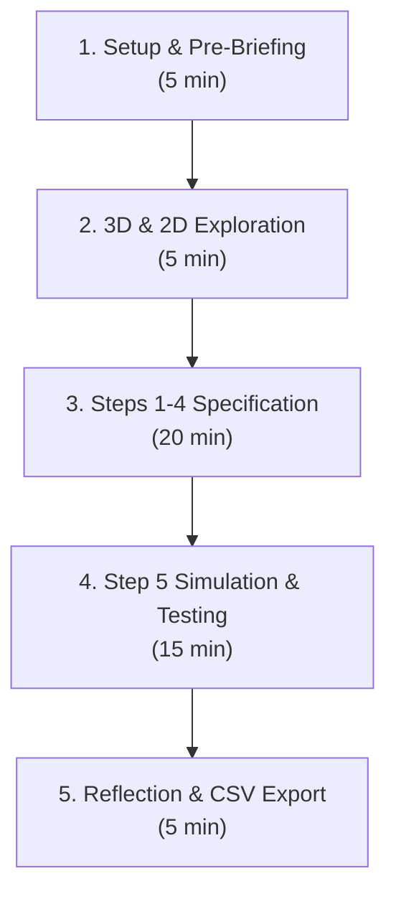

# 🤝 Research Partner & Collaborator Onboarding Guide

> **CollabPEAS: Dyadic PEAS Framework Collaborative AI Agent Design Platform**  
> *ACM CSCW '26 Research Study Protocol & Operations Manual*

---

## 🎯 Executive Overview

Welcome to the **CollabPEAS** research project! This guide provides research partners, lab members, and experiment facilitators with everything needed to:
1. Launch the platform locally in under 60 seconds with **zero dependencies**.
2. Understand the dyadic co-design experiment workflow (Player A & Player B).
3. Administer user study sessions and record empirical data.
4. Export and analyze timestamped interaction telemetry.

---

## ⚡ 60-Second Quickstart

### Prerequisites
- **Git**
- **Node.js** (v14+ recommended) **OR** **Python 3**
- A modern web browser: **Google Chrome**, **Apple Safari**, **Microsoft Edge**, or **Mozilla Firefox** (WebGL hardware acceleration enabled).

### 1-Command Launch
Clone the repository and start the local HTTP server:

```bash
# 1. Clone repository
git clone https://github.com/<your-username>/CollabPEAS.git
cd CollabPEAS

# 2. Start server (Option A: Node.js - recommended for smooth GLB streaming)
node collabpeas-2d/server.js 8088

# OR (Option B: Python 3 - zero configuration)
python3 -m http.server 8088
```

Open **`http://localhost:8088`** in your browser.

> [!NOTE]
> The repository is 100% self-contained. There is **no `npm install`**, no Webpack, and no third-party cloud build step. Three.js and loaders are included locally in `collabpeas-2d/lib/three/`.

---

## 👥 Dyadic Study Roles & Collaboration Mechanics

CollabPEAS investigates how pairs of non-expert human designers collaboratively specify household autonomous agents using the PEAS framework (**P**erformance, **E**nvironment, **A**ctuators, **S**ensors).

### 1. Participant Roles
| Role | Badge | Responsibilities | Key Actions |
| :--- | :---: | :--- | :--- |
| **Player A** | 🔵 **Lead** | Proposes agent design decisions; initial logic authoring; drives primary camera view | Adjusts metric sliders, selects sensors/actuators, places block rules |
| **Player B** | 🟣 **Reviewer** | Evaluates tradeoffs; identifies boundary bugs; validates safety conditions | Verifies sensor-actuator pairing, flags cat/human collision hazards, stamps observations |

*Note: Roles can be switched at any time using the `Player A` / `Player B` toggle in the top-right header.*

### 2. CSCW Scaffolding Mechanisms

#### A. Contribution Equity Bar
Located in the upper header, this live meter tracks the proportion of design actions authored by each participant:
$$\text{Equity Ratio} = \frac{\text{Actions}_{\text{Player A}}}{\text{Actions}_{\text{Player A}} + \text{Actions}_{\text{Player B}}}$$
If one partner dominates ($\ge 75\%$), the system visually prompts partners to invite reciprocal input.

#### B. Verbal Agreement Protocol (VAP)
When modifying high-impact components (deleting an active sensor, clearing block logic, or resetting metrics), a **2-second verbal alignment prompt** appears. This ensures dyadic grounding before destructive actions.

#### C. Dual Observation Logging & Divergence Detection
During Step 5 (Spatial Simulation), each participant independently stamps the robot's performance:
- <kbd>✓ Success</kbd>: Goal behavior observed (e.g., cleaned spill, avoided cat).
- <kbd>✗ Failure</kbd>: Robot stalled, collided with obstacle, or violated safety constraint.
- <kbd>? Ambiguous</kbd>: Unexpected behavior requiring discussion.

When Player A and Player B enter differing stamps within a 5-second window, the system triggers a **Divergence Alert** (`⚠️ Divergence Detected`), prompting partners to discuss before modifying rules.

---

## 🤖 The Autonomous Cleaning Robot Mechanics

When running Step 5 simulations, observe the autonomous cleaning robot:

### Visual Cues
- **Chassis**: High-contrast metallic disc ($r = 22\text{px}$ in 2D, $0.20\text{m}$ elevation in 3D).
- **Headlights**: Dual forward white light beams showing current forward heading.
- **Top Turret**: Animated 360° LiDAR spinner scanning room geometry.
- **Ground Halo**: Pulsing beacon ring expanding beneath the chassis.
- **State LED Indicator**:
  - 🔵 **Blue**: Vacuum motor active (`VACUUM ON`).
  - 🔷 **Cyan**: Mop deployed (`MOP DEPLOY`).
  - 🟡 **Amber**: Human detected nearby (`SET SPEED SLOW`).
  - 🔴 **Red**: Hazard avoidance / Cat emergency brake (`BRAKE STOP`).
  - 🟣 **Purple**: Low battery / Returning to charging dock (`DOCK RETURN`).
- **Overhead HUD Badge**: Unoccluded billboard label (`🤖 CLEANING ROBOT [ACTION • BATT%]`) rendered through walls.

### Locomotion & Pathfinding
1. **Multi-Ray Clearance Probing**: The robot projects 5 forward sensor rays ($\pm 0^\circ, \pm 30^\circ, \pm 60^\circ$) to detect walls and furniture.
2. **Smooth Angular Steering**: Angular velocity is smoothly clamped ($\le 0.22\text{ rad/tick}$) for realistic physical locomotion.
3. **Smart Obstacle Bypass**: If an obstacle blocks forward drive, the robot initiates a 1.2-second timed bypass trajectory to navigate around corners without getting stuck.
4. **Dynamic Target Acquisition**: Uncleaned dirt patches and liquid puddles are prioritized by proximity.

---

## 🔬 Running an Empirical Study Session

### Step-by-Step Facilitator Protocol



1. **Setup & Pre-Briefing (5 min)**:
   - Launch server at `http://localhost:8088`.
   - Seat participants together (co-located) or connect via audio/video call (remote).
   - Assign Player A (Blue) and Player B (Purple).
   - Select the target task from the Task Selector (e.g., `Task 1: Basic Floor Cleaning` or `Task 2: Living Room Spills & Cat Safety`).

2. **Apartment Exploration (5 min)**:
   - Allow participants 5 minutes to explore the apartment:
     - **3D 360° View**: Left-click drag to orbit, scroll to zoom, right-click to pan.
     - **360° Compass Rose**: Drag the compass dial or click cardinal buttons (<kbd>N</kbd>, <kbd>E</kbd>, <kbd>S</kbd>, <kbd>W</kbd>, <kbd>ISO</kbd>).
     - **FPS Walkthrough**: Press <kbd>W</kbd><kbd>A</kbd><kbd>S</kbd><kbd>D</kbd> to walk inside rooms at eye-level ($1.65\text{m}$).
     - **2D Blueprint**: View architectural rooms and teleport pads.
   - Familiarize with the 5 holographic station rings placed across rooms.

3. **Collaborative Specification (Steps 1–4, 20 min)**:
   - **Station 1 (Living Room)**: Adjust metric weights ($P$). Note the single-dominant penalty warning.
   - **Station 2 (Kitchen)**: Select up to 11 sensors ($S$). Discuss trade-offs between LiDAR, camera, bumper, and sonar.
   - **Station 3 (Foyer / Dock)**: Review actuator assembly ($A$).
   - **Station 4 (Dining Room)**: Build 4-slot logic block chains:
     $$\text{SENSE} \longrightarrow \text{CONDITION} \longrightarrow \text{ACTION} \longrightarrow \text{CONTROL}$$
     Ensure rules handle dirt detection, obstacle avoidance, human proximity, and cat safety.

4. **Simulation, Testing & Observation (Step 5, 15 min)**:
   - Click **`▶ Run Simulation`** in the floating bottom HUD.
   - Use **`🤖 Focus Robot`** or **`🎥 Follow Robot`** to track navigation.
   - Both participants independently stamp behavior using <kbd>✓</kbd>, <kbd>✗</kbd>, or <kbd>?</kbd>.
   - If performance stalls, pause simulation, discuss findings, re-open Station 4, iterate on rules, and re-run.

5. **Reflection & Data Export (5 min)**:
   - Inspect final PEAS scores (Coverage %, Battery %, Safety %, Noise Index).
   - In Station 5, click **`📥 Export Research Log (CSV)`**.
   - Save the generated `.csv` file with participant session ID (e.g., `P01_P02_SessionLog.csv`).

---

## 📊 Telemetry Data Schema

The exported CSV log aligns directly with `PeasSessionLog.cs` from the research specification:

| Field | Type | Description |
| :--- | :--- | :--- |
| `timestamp` | ISO String | UTC timestamp of event |
| `elapsed_sec` | Float | Seconds since session start |
| `player_id` | String | `Player_A` or `Player_B` |
| `event_type` | String | `UI_CLICK`, `STEP_TRANSITION`, `SLIDER_ADJUST`, `SENSOR_SELECT`, `BLOCK_ADD`, `BLOCK_CONNECT`, `SIM_START`, `SIM_STAMP`, `DIVERGENCE_ALERT`, `CSV_EXPORT` |
| `step_id` | Integer | Active workstation step (1 to 5) |
| `details` | JSON String | Event-specific payload (e.g., block rule formula, slider delta, stamp value) |
| `coverage_pct` | Float | Live cleaning coverage at event timestamp |
| `battery_pct` | Float | Robot battery level ($0 - 100\%$) |
| `collision_count` | Integer | Total collisions recorded |
| `equity_ratio` | Float | Current Player A contribution ratio |

---

## 🛠️ Frequently Asked Questions (FAQ)

### Q1: The 3D view shows a black screen or runs sluggishly.
- Ensure **Hardware Acceleration** is enabled in your browser:
  - Chrome: `Settings > System > Use hardware acceleration when available`.
  - Safari: `Develop > Experimental Features > WebGL 2.0`.
- If running on a virtual machine or low-power laptop, click **`📐 2D Map`** in the top header. The 2D engine is ultra-lightweight and runs smoothly on any hardware.

### Q2: Port 8088 is already in use.
Pass a custom port number to the server script:
```bash
node collabpeas-2d/server.js 8089
# or
python3 -m http.server 8089
```

### Q3: Audio effects are muted.
Modern browsers require a user interaction (click) on the page before playing Web Audio API sounds. Click anywhere on the map or press <kbd>Space</kbd> to unlock audio.

---

## 📬 Contact & Support
For research inquiries, bug reports, or co-authorship correspondence, please reach out to the lead author:
- **Haotian Yang** (`hyang57@u.rochester.edu`)
- University of Rochester & CSCW '26 Research Group
