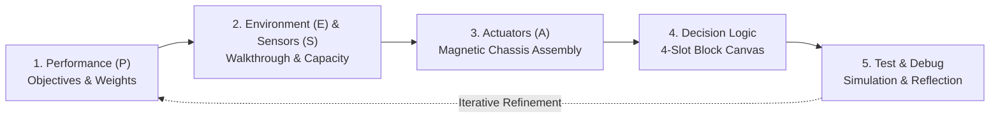

# CollabPEAS: Workflow & User Guide

> **A Comprehensive Guide to Designing, Simulating, and Debugging Household Autonomous Agents via the PEAS Framework**  
> *Companion Research Platform for CSCW '26 • Re-engineered from Fusion VR Training (`fusion-vr-training-2.0.6`)*

---

## 📖 Table of Contents
1. [Introduction & Educational Concept](#1-introduction--educational-concept)
2. [Interface Overview & Dual-Engine 360° Navigation](#2-interface-overview--dual-engine-360-navigation)
   - [3D 360° Orbit View (WebGL + Apartment.glb)](#21-3d-360-orbit-view)
   - [First-Person 360° Walkthrough (FPS Mode)](#22-first-person-360-walkthrough-fps-mode)
   - [2D Rotatable Blueprint Canvas](#23-2d-rotatable-blueprint-canvas)
   - [Interactive 360° Compass Widget](#24-interactive-360-compass-widget)
   - [Robot Perspective (POV Mode)](#25-robot-perspective-pov-mode)
3. [Step-by-Step PEAS Design Workflow](#3-step-by-step-peas-design-workflow)
   - [Step 1: Define Your Agent (Performance Measure — P)](#step-1-define-your-agent-performance-measure--p)
   - [Step 2: Know Your World (Environment — E & Sensors — S)](#step-2-know-your-world-environment--e--sensors--s)
   - [Step 3: Give Your Robot a Body (Actuators — A)](#step-3-give-your-robot-a-body-actuators--a)
   - [Step 4: Program Your Robot (Decision Logic / Vibe Coding)](#step-4-program-your-robot-decision-logic--vibe-coding)
   - [Step 5: Test, Debug, and Reflect (PEAS Iteration)](#step-5-test-debug-and-reflect-peas-iteration)
4. [Cleaning Robot Visualization & Simulation Tracking](#4-cleaning-robot-visualization--simulation-tracking)
   - [3D Robot Features & Dynamic Status Lighting](#41-3d-robot-features--dynamic-status-lighting)
   - [Camera Tracking Controls ("Focus Robot" & "Follow Robot")](#42-camera-tracking-controls)
   - [Full-Screen Live Simulation Mode](#43-full-screen-live-simulation-mode)
5. [Dyadic CSCW Collaboration Features](#5-dyadic-cscw-collaboration-features)
   - [Symmetric Dual-Role Switching (Player A / Player B)](#51-symmetric-dual-role-switching)
   - [Contribution Equity Gauge](#52-contribution-equity-gauge)
   - [Dual Observation Logging & Divergence Analysis](#53-dual-observation-logging--divergence-analysis)
   - [2-Second Verbal Agreement Protocol](#54-2-second-verbal-agreement-protocol)
   - [Spatially Embedded PEAS Reflection & CSV Export](#55-spatially-embedded-peas-reflection--csv-export)
6. [Quick Reference & Shortcut Cheat Sheet](#6-quick-reference--shortcut-cheat-sheet)
7. [Running & Testing Locally](#7-running--testing-locally)

---

## 1. Introduction & Educational Concept

### What is CollabPEAS?
**CollabPEAS** is an interactive collaborative learning platform designed to teach the fundamentals of Artificial Intelligence agent specification using the classical **PEAS** framework (Russell & Norvig, *Artificial Intelligence: A Modern Approach*):
- **P** — **Performance Measure**: What metrics determine success or failure?
- **E** — **Environment**: What kind of world does the agent operate in (fully/partially observable, static/dynamic, deterministic/stochastic)?
- **A** — **Actuators**: What physical tools, motors, and end-effectors can the agent use to change the state of the world?
- **S** — **Sensors**: What hardware inputs provide the agent with percepts about its surroundings?

### The Core Pedagogical Insight: "Bounded Rationality"
The fundamental lesson students learn through CollabPEAS is that **an AI agent is not magically omniscient**:
> *An agent's rationality is strictly bounded by its specification. When a robot makes a "stupid" mistake—such as running over a wet spill or crashing into a cat—it is almost always behaving **completely rationally** according to its sensors, actuators, and program logic, but the human designer gave it an incomplete or mismatched specification!*

Originally developed in Unity VR using Photon Fusion (`fusion-vr-training-2.0.6`), this web application provides a **desktop-accessible, zero-dependency, 360-degree interactive environment** for empirical research comparison (VR condition vs. Web Desktop condition).

---

## 2. Interface Overview & Dual-Engine 360° Navigation

The CollabPEAS interface combines a full-screen spatial canvas with floating frosted-glass workstations, a bottom simulation HUD, and a top navigation and collaboration bar.

```
┌────────────────────────────────────────────────────────────────────────────────────────────────────────┐
│  [CollabPEAS 3D/2D]   [Step 1] [Step 2] [Step 3] [Step 4] [Step 5]   [Player A/B] [Equity Bar]  [🧭 N] │
├────────────────────────────────────────────────────────────────────────────────────────────────────────┤
│                                                                                                        │
│                                    3D / 2D APARTMENT CANVAS                                            │
│                                                                                                        │
│        [Station 2: Sensors]                          [Station 1: Purpose]                              │
│             (Kitchen)                                    (Living Room)                                 │
│                                                                                                        │
│                                  🤖 CLEANING ROBOT                                                      │
│                                  (Active Navigation)                                                   │
│                                                                                                        │
│        [Station 3: Actuators]                        [Station 5: Test & Debug]                         │
│             (Dock Bay)                                   (Master Bed)                                  │
│                                                                                                        │
├────────────────────────────────────────────────────────────────────────────────────────────────────────┤
│  [▶ Play/Pause] [1x/2x/5x]   [Coverage: 85%] [Safety: 92%] [Score: 88.4]   [🤖 Focus] [🎥 Follow]   │
└────────────────────────────────────────────────────────────────────────────────────────────────────────┘
```

### 2.1. 3D 360° Orbit View
Rendered with Three.js using the high-poly `Apartment.glb` model (419 nodes, 220 meshes):
- **Rotate / Orbit 360°**: Click and hold the **Left Mouse Button**, then drag in any direction. You can orbit a complete 360 degrees horizontally around the apartment, and tilt vertically from birds-eye top-down (90°) down to floor level.
- **Zoom**: Scroll the **Mouse Wheel** to smoothly zoom in on specific rooms or zoom out to inspect the entire apartment layout.
- **Pan Camera**: Click and hold the **Right Mouse Button**, then drag to pan the camera across different rooms.
- **Walk Avatar to Point**: Left-click on any empty floor space. A raycaster will detect the floor coordinate and the Operator Avatar will smoothly walk there.
- **Open Holographic Stations**: Left-click directly on any glowing holographic station ring on the floor to immediately open that step's workstation modal.

### 2.2. First-Person 360° Walkthrough (FPS Mode)
Click **`🚶 FPS 360°`** in the top view-mode selector:
- The camera drops down to realistic human eye-level ($1.65\text{m}$) inside the apartment.
- Use <kbd>W</kbd><kbd>A</kbd><kbd>S</kbd><kbd>D</kbd> or the **Arrow Keys** to walk forward, backward, or strafe left and right through doorways.
- Click and drag the mouse to look around in a full 360° panoramic sphere.
- Experience the physical room layout from the true perspective of a human occupant.

### 2.3. 2D Rotatable Blueprint Canvas
Click **`📐 2D Map`** in the top view-mode selector:
- Displays a crisp, procedurally drafted architectural floor plan with textured room zones (Herringbone oak in living room, marble tiles in kitchen, slate stone in bathroom, hex grid in assembly bay).
- **Rotate 360°**: Press <kbd>Q</kbd> to rotate counter-clockwise or <kbd>E</kbd> to rotate clockwise.
- **Fast Teleport**: Click any of the glowing teleport pads (`🛋️ Living Room`, `🍳 Kitchen`, `🍽️ Dining Room`, `🛏️ Master Bed`, `🦾 Assembly Bay`) to instantly jump there.

### 2.4. Interactive 360° Compass Widget
Located at the top right of the screen:
- **Heading Readout**: Shows the real-time camera azimuth in degrees and cardinal direction (e.g., `🧭 0° N`, `🧭 45° NE`, `🧭 90° E`, `🧭 180° S`, `🧭 270° W`).
- **Interactive Drag Dial**: Click and drag the compass rose needle to smoothly rotate the entire 3D or 2D apartment view.
- **Snap Buttons**:
  - <kbd>N</kbd>: Snap camera directly to North (0°).
  - <kbd>E</kbd>: Snap camera to East (90°).
  - <kbd>S</kbd>: Snap camera to South (180°).
  - <kbd>W</kbd>: Snap camera to West (270°).
  - <kbd>ISO</kbd>: Snap camera to standard 45° Isometric perspective.
  - <kbd>🔄</kbd>: Toggle continuous cinematic 360° orbit rotation.

### 2.5. Robot Perspective (POV Mode)
Click the **`👁️ Robot POV`** button in the top navigation bar or inside Step 2:
- Displays what the robot actually "sees" through its currently mounted sensors.
- Renders a 120° visual cone, ultrasonic rangefinder detection arcs, floor moisture sensor readings, and dirt particle detectors.
- If a sensor has not been mounted (e.g., missing cliff sensor or moisture probe), the HUD displays prominent **BLIND SPOT WARNING** indicators.

---

## 3. Step-by-Step PEAS Design Workflow

Learners progress through five interconnected design workstations. You can access any workstation by clicking its button in the top bar or walking near its holographic floor station in the apartment and pressing <kbd>Space</kbd>.



---

### Step 1: Define Your Agent (Performance Measure — P)

```
Location: Station 1 (Living Room)
Holographic Color: Cyan Ring & Star Beacon
```

In this step, partners define the robot's high-level purpose and configure its mathematical objective function.

1. **Select a Household Mission**:
   Choose from 6 authentic household tasks:
   - **Task 1: Clean Living Room Floor** (Primary: Floor coverage; Secondary: Low time).
   - **Task 2: Pick Up Scattered Toys** (Primary: Hazard response & object handling).
   - **Task 3: Clean Kitchen Spills** (Primary: Moisture detection and emergency containment).
   - **Task 4: Avoid Roaming Cat** (Primary: Safety and collision avoidance).
   - **Task 5: Assist Elderly Resident** (Primary: Proximity slowdown and voice alerts).
   - **Task 6: Return to Dock on Low Battery** (Primary: Battery threshold monitoring and auto-docking).
2. **Formulate Agent Purpose**:
   Enter a concise sentence summarizing what the robot should accomplish.
3. **Configure Objective Function Sliders**:
   Adjust the four normalized weight sliders ($0\% - 100\%$):
   - **Floor Coverage Weight**: Prioritizes vacuuming and sweeping clean floor tiles.
   - **Safety Weight**: Penalizes collisions with walls, furniture, the avatar, and the roaming cat.
   - **Time Efficiency Weight**: Rewards fast mission completion and minimal idling.
   - **Hazard Response Weight**: Rewards immediate mop deployment on liquid spills and cable avoidance.
4. **Inspect Priority Profile Feedback**:
   The system calculates the dominant priority and alerts partners if a single weight exceeds 70% (*"Warning: Single-dominant metric may cause robot to ignore critical safety or spill hazards"*).

---

### Step 2: Know Your World (Environment — E & Sensors — S)

```
Location: Station 2 (Kitchen)
Holographic Color: Emerald Ring & Radar Beacon
```

In this step, partners inspect the apartment environment properties and select the sensory hardware package.

1. **Perform the Environment Walkthrough**:
   Walk the avatar through the apartment to inspect 5 pedagogical educational markers:
   - 📍 **Kitchen Spill**: Partially observable (cannot be detected until near or underfoot).
   - 📍 **Roaming Cat**: Dynamic environment (moves continuously on its own patrol path).
   - 📍 **Living Room Clutter**: Discrete vs. continuous navigation challenge.
   - 📍 **Hallway Power Cable**: Sensor-specific limitation (ultrasonic waves bounce over thin cords).
   - 📍 **Charging Dock**: Goal localization beacon.
2. **Select Sensors from the Hardware Procurement Palette**:
   The hardware catalog contains **15 sensors** (11 valid, 4 distractors):
   - *Valid Sensors*: Front Distance LiDAR, Floor Dirt Optical Sensor, Floor Moisture Sensor, Bump Sensor (Bumper Switch), Cat IR Heat Signature Sensor, Low Battery Voltage Monitor, Wall Following Sonar, Cliff Sensor, Wheel Encoder, Docking IR Signal Receiver, Human Proximity PIR Sensor.
   - *Distractor Sensors*: Ambient Light Sensor, Room Thermometer, Acoustic Microphone, Barometric Pressure Sensor.
3. **Manage the 11-Slot Chassis Capacity Budget**:
   The robot's chassis has an absolute physical limit of **11 sensor mounting slots**. Learners must debate trade-offs (e.g., "Do we need the Human Proximity Sensor, or can the Front LiDAR handle both walls and humans?"). At least 8 sensors must be mounted.
4. **Inspect the Percept Sequence Summary**:
   The system displays the *Bounded Percept Sequence* showing what the robot **CAN** perceive vs. what it **CANNOT** perceive.

---

### Step 3: Give Your Robot a Body (Actuators — A)

```
Location: Station 3 (Assembly & Docking Bay)
Holographic Color: Amber Ring & Wrench Beacon
```

Inspired by the Fusion VR Training sample's magnetic structure assembly (`ActivityMagnetStructureAttachment.cs`), partners assemble the physical mechanics of the robot.

1. **Snap Hardware Modules to the Magnetic Chassis**:
   Drag or click actuators from the inventory onto the robot's physical mounting points:
   - **Locomotion**: Dual Wheel Drive Motors, Steering Turntable Pivot, Emergency Dynamic Brake.
   - **Cleaning Tools**: High-Torque Vacuum Impeller, Retractable Mop Assembly, Side Edge Sweepers.
   - **Manipulation**: Telescopic Robotic Arm, Gripper Claw End-Effector.
   - **Signaling & Docking**: High-Current Docking Connector, Status LED Ring, Audio Speaker Buzzer.
2. **Review Actuator Limitations**:
   Each actuator displays its physical limitations (e.g., *"Mop Assembly requires 2.5 seconds to deploy"*, *"Gripper Claw cannot pick up liquid spills"*).
3. **Verify Capability Integrity**:
   The system prevents learners from proceeding until mandatory locomotion and cleaning tools are mounted.

---

### Step 4: Program Your Robot (Decision Logic / Vibe Coding)

```
Location: Station 4 (Dining Room)
Holographic Color: Violet Ring & Logic Node Beacon
```

In this step, partners construct the robot's autonomous decision policy using a strict 4-slot visual rule pipeline.

```
┌─────────────────┐   ┌─────────────────┐   ┌─────────────────┐   ┌─────────────────┐
│ Slot 1: SENSE   │──>│ Slot 2: COND    │──>│ Slot 3: ACTION  │──>│ Slot 4: CTRL    │
│ [Front LiDAR]   │   │ [Distance < 0.4m│   │ [Brake & Turn]  │   │ [Priority: HIGH]│
└─────────────────┘   └─────────────────┘   └─────────────────┘   └─────────────────┘
```

1. **4-Slot Block Syntax**:
   Every rule must follow the strict syntactic chain:
   - **Slot 1 (SENSE)**: The hardware percept source (e.g., `SENSE_01: Front LiDAR`, `SENSE_04: Cat IR Heat`).
   - **Slot 2 (CONDITION)**: The logical threshold (e.g., `COND_01: Obstacle < 0.5m`, `COND_03: Moisture > 60%`).
   - **Slot 3 (ACTION)**: The actuator command to trigger (e.g., `ACT_01: Forward`, `ACT_04: Deploy Mop`, `ACT_05: Brake`).
   - **Slot 4 (CONTROL / Optional)**: Execution modifiers (e.g., `CTRL_01: Loop`, `CTRL_05: Priority Interrupt`).
2. **Automated Compatibility Enforcement**:
   The logic engine strictly checks data types. If a student attempts to connect a `Cat IR Sensor` to a `Moisture > 50%` condition, the block bounces with an immediate red incompatible warning!
3. **Parallel Rule Execution Hierarchy**:
   At runtime, rules evaluate simultaneously at 10Hz. Priority modifiers (`CTRL_05`) allow emergency safety rules (e.g., stopping for the cat) to preempt routine vacuuming sweeps.
4. **One-Click Default Pipeline**:
   Click **`📥 Load Recommended Rule Pipeline`** to instantly populate a proven baseline ruleset if needed.

---

### Step 5: Test, Debug, and Reflect (PEAS Iteration)

```
Location: Station 5 (Master Bedroom)
Holographic Color: Rose Ring & Diagnostic Beacon
```

Step 5 is the experimental laboratory where partners run the live simulation, evaluate scores, log observations, and perform guided debugging.

---

## 4. Cleaning Robot Visualization & Simulation Tracking

### 4.1. 3D Robot Features & Dynamic Status Lighting
The Cleaning Robot in the 3D Apartment (`Apartment.glb`) is rendered with high-visibility engineering assets sitting flush on top of the floor slab ($y = 0.20\text{m}$ elevation):

```
                   [ 🤖 CLEANING ROBOT ]             <-- Always-Visible Billboard Sprite
                   [ ⚙️ VACUUMING • 🔋 88% ]
                             │
                      ┌──[LIDAR]──┐                  <-- Rotating Top Scanner
                 ┌────┴───────────┴────┐
           (===) │   METALLIC CHASSIS  │ (===)       <-- Metallic Charcoal Body
                 └───────┬─────┬───────┘
                     💡  │ LED │  💡                 <-- Dual Forward Headlights
                         └──o──┘                     <-- State-Reactive LED Halo Ring
                  ◎◎◎ GROUND BEACON ◎◎◎              <-- Pulsing Cyan Target Halo
```

- **Rotating Top LiDAR Turret**: Spins continuously at 180°/sec on top of the chassis.
- **Dual Forward Headlights**: Cast two bright illumination beams in front of the robot along its movement trajectory.
- **Pulsing Ground Halo**: A glowing ring on the floor beneath the robot that pulses rhythmically, ensuring the robot is easily spotted even when zoomed all the way out.
- **Dynamic State-Reactive LED Ring**:
  - 🔵 **Vibrant Blue**: Active Vacuuming & Sweeping clean floor.
  - 🟢 **Bright Cyan**: Moisture Detected / Active Mop Deployed.
  - 🟡 **Amber**: Slowing down near the human avatar.
  - 🔴 **Vivid Red**: Safety Brake engaged (cat collision avoidance).
  - 🟣 **Neon Purple**: Returning to dock / Low battery mode.
  - ⚪ **Green / White**: Idle / Ready.
- **Unoccluded Billboard Tag**:
  - Floats above the robot with `depthTest: false`, ensuring it is **never hidden behind walls or furniture**.
  - Displays: `🤖 CLEANING ROBOT` and `⚙️ [CURRENT ACTION] • 🔋 [BATTERY]%`.

### 4.2. Camera Tracking Controls
Use the dedicated camera tracking buttons in the bottom simulation HUD or top navbar:
- **`🤖 Focus Robot`**: Instantly snaps and centers the 3D camera (or 2D map view) directly onto the Cleaning Robot's current room coordinates, retaining a comfortable observation zoom level.
- **`🎥 Follow Robot`**: Locks the camera onto the Cleaning Robot in continuous follow mode. As the robot navigates between rooms, turns around obstacles, and drives to the charging dock, the camera smoothly tracks its movement in real-time.

### 4.3. Full-Screen Live Simulation Mode
Inside Step 5, click **`🗺️ Watch in Full-Screen Map`**:
1. The workstation modal smoothly slides closed.
2. The simulation automatically unpauses at 1x speed.
3. The camera automatically focuses on the Cleaning Robot.
4. The bottom floating HUD displays live score gauges:
   - **Floor Coverage Gauge**: Percentage of apartment floor cleaned.
   - **Safety Rating**: Collision penalty accumulator.
   - **Time Elapsed**: Mission timer and battery consumption.
   - **Hazard Response**: Clearance of water spills and cable avoidance.
   - **Composite PEAS Score**: Weighted composite metric according to Step 1 sliders.

---

## 5. Dyadic CSCW Collaboration Features

CollabPEAS is specifically architected to support two participants working together synchronously in front of the application:

### 5.1. Symmetric Dual-Role Switching
In the top right navigation bar, click the **Role Selector**:
- **Player A (Lead Designer)**: Blue theme accent.
- **Player B (System Reviewer)**: Purple theme accent.
- Every action taken in the system (mounting a sensor, snapping a logic block, adjusting a weight, logging an observation) is tagged with the active `PlayerID` for empirical research telemetry.

### 5.2. Contribution Equity Gauge
The header features a real-time **Mutual Contribution Equity Bar**:
- Visualizes the proportion of interactions generated by Player A vs. Player B.
- Prompts partners when interaction becomes one-sided, encouraging active collaboration and verbal discussion.

### 5.3. Dual Observation Logging & Divergence Analysis
During live simulation runs, both partners record their independent observations:
- Click **`✓` (Success)**: Behavior met the PEAS specification.
- Click **`✗` (Failure)**: Robot exhibited erroneous or dangerous behavior.
- Click **`?` (Ambiguity)**: Unclear or edge-case behavior requiring discussion.
- **Automated Divergence Highlighting**:
  If Player A records a `✓` while Player B records a `✗` for the same event, the system flags the conflict with a glowing divergence badge (*"Observation Divergence Detected! Discuss with your partner before modifying rules"*).

### 5.4. 2-Second Verbal Agreement Protocol
Whenever either partner attempts to make a **Debug Move** (swapping a block, adding a rule, or going back to change hardware):
- A frosted-glass dialog locks the screen for **2 seconds**:
  > *"🗣️ Verbal Agreement Checkpoint: Explain your diagnosis to your partner. Do both of you agree this change addresses the root cause of the error?"*
- Once the 2-second reflection timer expires, the **`Confirm & Apply Change`** button unlocks.

### 5.5. Spatially Embedded PEAS Reflection & CSV Export
At the conclusion of the session, partners answer the diagnostic reflection prompt:
> *"Did your robot behave irrationally — or rationally with an incomplete/incorrect specification?"*

Click **`📋 View Final PEAS Summary & Export CSV`**:
- Displays complete mission statistics: Final PEAS score, total distance navigated, spills cleared, collisions avoided, and partner equity percentages.
- **`⬇️ Download Research Session CSV`**: Generates a standardized research log file containing millisecond-accurate timestamps, event types, player IDs, and state snapshots, matching the schema of `PeasSessionLog.cs`.

---

## 6. Quick Reference & Shortcut Cheat Sheet

### Viewport Navigation
| Key / Gesture | 3D Orbit Mode | 2D Blueprint Mode | FPS Walkthrough Mode |
| :--- | :--- | :--- | :--- |
| **Left Mouse Drag** | Orbit camera 360° | Pan floor plan | Look around 360° |
| **Right Mouse Drag** | Pan camera across floor | Pan floor plan | — |
| **Mouse Wheel** | Zoom in / out | Zoom in / out | — |
| <kbd>W</kbd><kbd>A</kbd><kbd>S</kbd><kbd>D</kbd> / **Arrows** | Walk operator avatar | Walk operator avatar | Walk operator at eye level |
| <kbd>Q</kbd> / <kbd>E</kbd> | Spin camera left / right | Rotate 2D map 360° | Turn camera left / right |

### General Shortcuts
| Key / Control | Action |
| :--- | :--- |
| <kbd>Space</kbd> | Open nearest Step Workstation (or toggle current modal) |
| <kbd>Esc</kbd> | Close workstation modal and return to full-screen map |
| **Compass Buttons** | Snap camera to **N** (0°), **E** (90°), **S** (180°), **W** (270°), or **ISO** (45°) |
| **`🔄` Button** | Toggle continuous cinematic 360° orbit rotation |
| **`🤖 Focus Robot`** | Snap camera view directly to the Cleaning Robot |
| **`🎥 Follow Robot`** | Toggle continuous dynamic camera chase on the Cleaning Robot |
| **`👁️ Robot POV`** | Open sensor-filtered first-person perspective HUD |

---

## 7. Running & Testing Locally

The web application runs entirely client-side with zero external build tools, package installations, or internet connectivity required.

### 1. Start Local Server
From the project root:
```bash
# Using Node.js (Recommended - supports byte-range streaming for GLB)
node collabpeas-2d/server.js 8088

# Or using Python 3
python3 -m http.server 8088
```

### 2. Open in Browser
Navigate to:
```
http://localhost:8088
```

### 3. Recommended Browsers
- Google Chrome (v110+)
- Apple Safari (v16+)
- Mozilla Firefox (v115+)
- Microsoft Edge (v110+)

*Web Audio API and WebGL 2.0 hardware acceleration should be enabled for optimal 60 FPS performance.*
